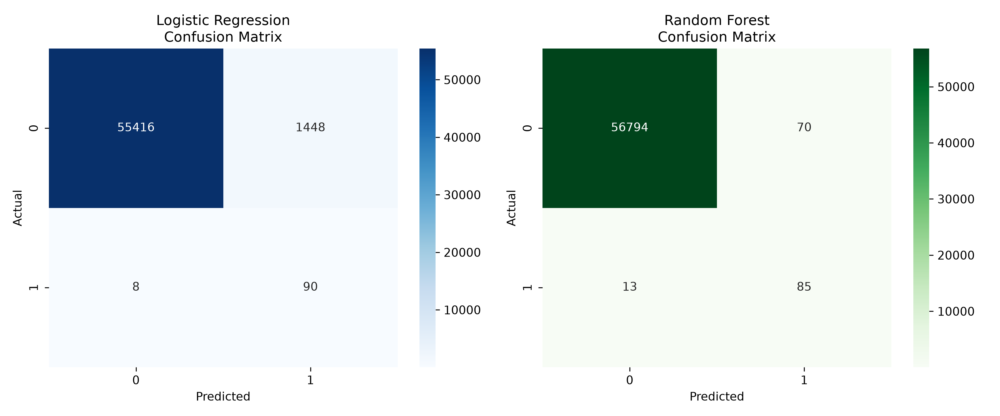
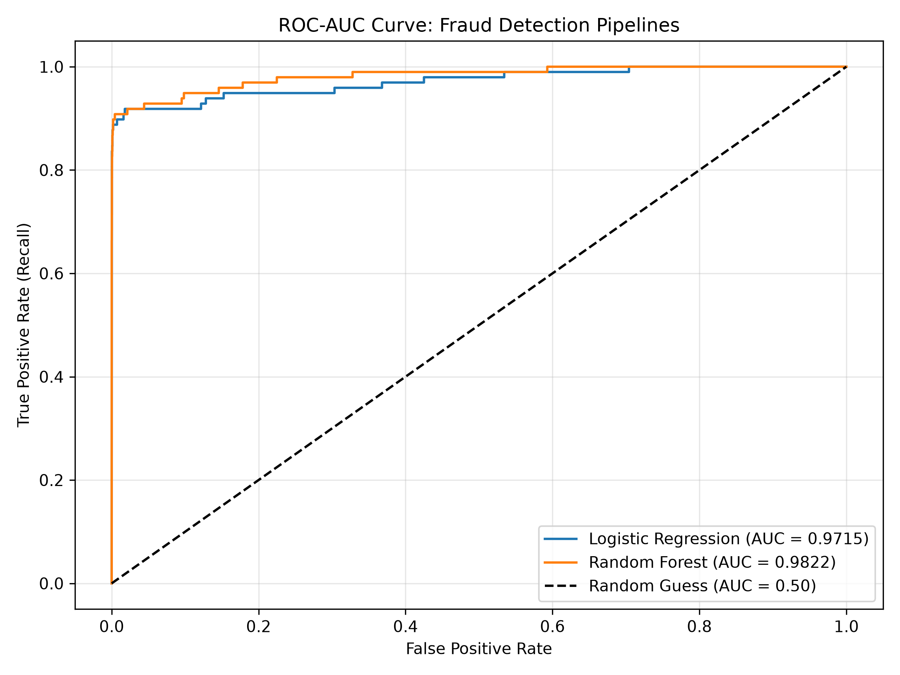

# Fraud Detection Pipeline (Supervised Learning)
**DecodeLabs Industrial Training — Project 2**

## Project Overview
Financial transaction datasets suffer from extreme class imbalance. In this dataset of **284,807 transactions**, **99.83%** are legitimate and only **0.17%** (492 cases) are fraudulent. A naive model that predicts "Legitimate" for every transaction achieves 99.83% accuracy while catching zero fraud.

This project implements a **leak-free machine learning pipeline** using `imblearn` and `scikit-learn` to detect fraudulent transactions, discarding misleading Accuracy metrics in favor of **Precision, Recall, F1-Score, and ROC-AUC**.

---

## Architecture & Zero-Leakage Protocol
To ensure the test set accurately reflects real-world class imbalance without data leakage:
1. **Stratified Train/Test Split (80/20):** Performed *before* any scaling or resampling, isolating **56,962 untouched test transactions** (98 fraud cases).
2. **`imblearn.pipeline.Pipeline`:** Wraps preprocessing, **SMOTE** (Synthetic Minority Over-sampling Technique), and classification so synthetic samples are generated *only* within the training folds.
3. **5-Fold Stratified Cross-Validation (`GridSearchCV`):** Holistically tunes SMOTE (`k_neighbors`) and classifier hyperparameters while optimizing for `roc_auc`.
4. **Model-Specific Preprocessing:**
   * **Logistic Regression Pipeline:** `StandardScaler` → `SMOTE` → `LogisticRegression` (scaling is required for linear regularization).
   * **Random Forest Pipeline:** `SMOTE` → `RandomForestClassifier` (tree-based models are invariant to feature scale).

---

## Final Model Comparison (Untouched Test Set)

| Model | Best Hyperparameters | Precision (Fraud) | Recall (Fraud) | F1-Score (Fraud) | ROC-AUC |
| :--- | :--- | :---: | :---: | :---: | :---: |
| **Logistic Regression** | `C=0.01`, `k_neighbors=5` | 5.85% | **91.84%** | 0.1100 | 0.9715 |
| **Random Forest** | `max_depth=10`, `k_neighbors=3` | **54.84%** | 86.73% | **0.6719** | **0.9822** |

### Key Findings
* **Random Forest is the clear production winner:** While Logistic Regression caught slightly more fraud (90 vs. 85 out of 98 cases), its linear decision boundary generated **1,448 false positives**, which would cause severe customer frustration from false declines.
* **Precision-Recall Balance:** Random Forest's non-linear decision boundary improved Precision by **~9.4x** (from 5.85% to 54.84%) and lifted the F1-Score from 0.1100 to **0.6719**, while achieving an **ROC-AUC of 0.9822** (exceeding the 0.85+ benchmark).
* **Preventing Overfitting:** Limiting tree depth (`max_depth=10`) with `k_neighbors=3` outperformed deeper trees (`20` and `None`) by preventing the ensemble from overfitting to synthetic SMOTE samples.

---

## Visualizations

### Confusion Matrices


### ROC-AUC Curve Comparison


---

## How to Run
1. Install dependencies:
   ```bash
   pip install pandas numpy scikit-learn imbalanced-learn matplotlib seaborn